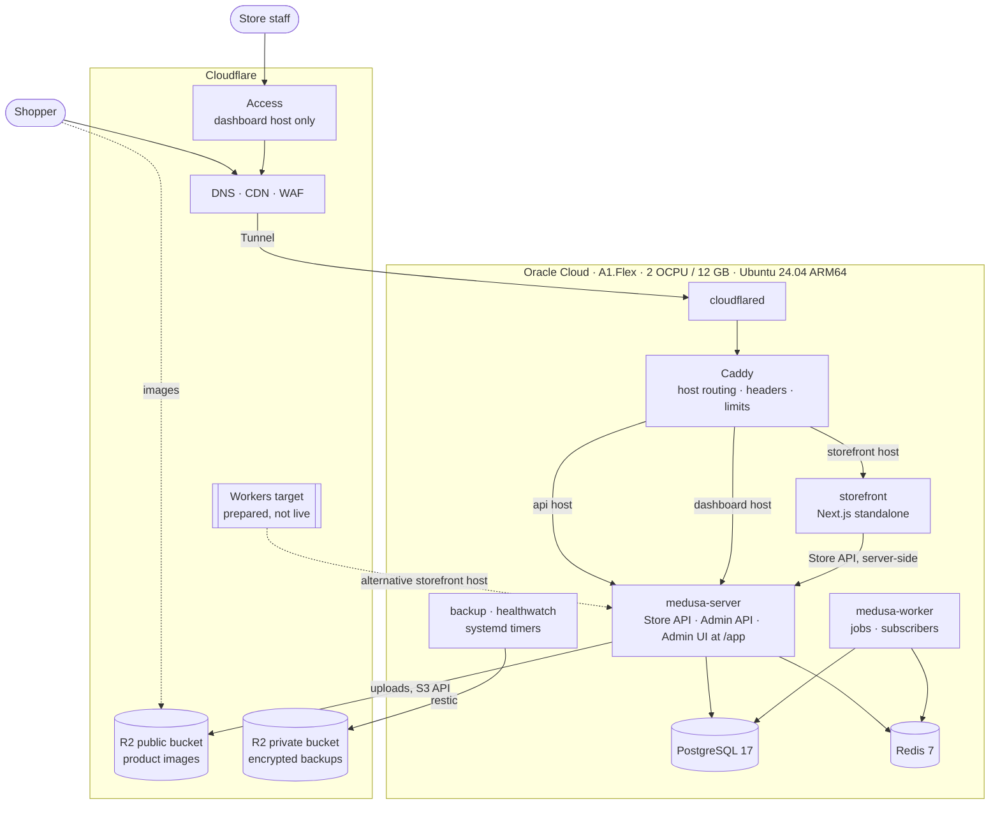

# Architecture

BONANZA is the website of a barbershop and its academy, with an online store for professional barber equipment and grooming products, sold in Israel in ILS. It is written in Hebrew, English and Arabic. This document describes how the system is put together and why.

## System overview

## Components

| Component | Technology | Responsibility |
|---|---|---|
| Storefront | Next.js 16 (App Router), React 19, Tailwind 4, TypeScript | Everything a visitor sees: the barbershop pages (booking link, price list, gallery, reviews, contact) and the store. Hebrew, English and Arabic. Talks to Medusa's Store API from the server. Holds no pricing logic. |
| Commerce backend | Medusa 2.23 | Catalog, categories, variants, inventory, prices, promotions, carts, orders, customers, fulfillment, tax, payments, authentication. |
| Admin dashboard | Medusa Admin, extended | Products, orders, customers, inventory, promotions (built in) plus site content (home page, price list, gallery, team, reviews, menus, pages, settings), brands and an activity log (custom extensions). |
| Database | PostgreSQL 17 | All business data, including CMS content. |
| Queue, events, locks, sessions | Redis 7 | Medusa's event bus, workflow engine, locking and admin sessions. |
| Media | Cloudflare R2 through Medusa's S3 file provider | Product and content images. Local disk in development. |
| Reverse proxy | Caddy 2 | Routes by hostname, sets security headers, caps request sizes, hides admin routes from the public API host. |
| Ingress | Cloudflare Tunnel | Connects Cloudflare to Caddy with no inbound ports open on the VM. |

## Hostnames

Production hostnames are planned as below. The domain is not owned yet, so every hostname comes from environment variables and temporary URLs are used until then.

| Hostname | Serves | Reachable paths |
|---|---|---|
| `bonanza.co.il` (and `www`, redirected) | Storefront | All storefront routes |
| `api.bonanza.co.il` | Medusa Store API | `/store/*`, `/auth/customer/*`, `/auth/session`, `/auth/token/refresh`, `/hooks/*`, `/static/*` (uploaded files when no media bucket is set), `/health`, and `/dev-gateway/pay/*` while the simulated payment page is enabled. Everything else, including `/admin`, `/app` and admin sign-in, is refused. |
| `dashboard.bonanza.co.il` | Medusa Admin | `/` redirects to `/app`. `/app`, `/admin/*`, `/auth/*`. `/store` and `/hooks` are refused. |
| media hostname | R2 public bucket | Images only |

Two points about the dashboard:

- **The admin path is `/app`.** That is Medusa's default and is confirmed from the build output. `/admin` is the Admin API, not the dashboard.
- **The dashboard and its API share one origin.** The admin UI calls the API on the hostname it was loaded from, so no cross-origin requests are involved, the session cookie is scoped to that one host, and the same built image works under any domain.

A subdomain is not a security boundary on its own. Access to admin functionality is enforced in three places: Medusa authenticates every `/admin` route, Caddy refuses admin paths on the public API hostname, and Cloudflare Access can require a second sign-in on the dashboard hostname.

## Storefront hosting: two targets from one codebase

The brief prefers Cloudflare Workers for the storefront. Two findings changed how that is delivered.

**Workers Free cannot reliably run a server-rendered store.** The free plan allows 10 ms of CPU per request. Cloudflare's documentation puts server-side rendering at 10–20 ms. Requests that exceed the limit fail with error 1102. The next limits to bite are 50 subrequests per request and 100,000 requests per day. Workers Paid costs $5 per month.

**`vinext` was evaluated and not adopted.** Cloudflare's documentation now names it the default for new Next.js apps but labels it beta. Its README says it is "not yet a drop-in replacement for every application or production workload" and calls OpenNext "the safer choice". It is a reimplementation of the Next.js API on Vite, so it does not run Next.js itself; Cache Components, custom image loaders and font handling differ.

The storefront is therefore a standard Next.js application with two build targets:

| Target | Runs on | Cost | Status |
|---|---|---|---|
| Node standalone container | The Oracle VM, behind Cloudflare's CDN | $0 | Default |
| `@opennextjs/cloudflare` | Cloudflare Workers | $5/month realistically | Built and smoke-tested, not deployed |

Code is kept portable between them: no Cache Components, no edge runtime, configuration through environment variables. The Workers build was built and run in Cloudflare's local emulator on 2026-11-23; see `cloudflare-deployment.md`. A `vinext check` step in CI was planned as an early warning and has not been added.

## Backend process model

One container image runs in two modes:

- `medusa-server`: HTTP only (Store API, Admin API, Admin UI).
- `medusa-worker`: scheduled jobs, subscribers and background workflows, with the admin disabled.

Splitting them keeps background work from running twice and from competing with requests.

## Custom Medusa modules

Medusa's own features are used wherever they exist. These modules add what it does not provide:

| Module | Adds |
|---|---|
| `cms` | Homepage sections, the service price list, gallery, team, reviews, banners, content pages, navigation menus, site settings, newsletter sign-ups |
| `brand` | Brands, linked to products |
| `activity-log` | A record of who changed content, brands and admin users |
| `dev-gateway` | The stand-in payment company behind the simulated provider: its charges and its hosted page |
| `payment-dev-hosted` | A simulated hosted-page payment gateway for development |
| `notification-smtp` | Email over SMTP |

Details are in `cms-management.md`, `payments-integration.md` and `security.md`.

## Request and data flows

**Browsing.** The home page, product pages, the gallery, brand and content pages are rendered on their first request, cached, and refreshed on a timer and on demand. They never read cookies, so the CDN can cache them. Catalog listings depend on the query string (search, filters, sorting, page number), so they are rendered per request from catalog data that is itself cached. The cart badge and sign-in state load in the browser afterwards. When staff change a product, content or a translation, a Medusa subscriber calls a signed endpoint on the storefront to refresh the affected pages.

**Cart, checkout, account.** These pages are rendered per request and are never cached. The cart id and the customer token are stored in httpOnly cookies set by the storefront server.

**Prices.** Medusa calculates every price, discount, tax and total. The storefront only displays them.

**Payment.** The storefront asks Medusa to start a payment. The payment provider returns a hosted page to redirect to. An order is created only after Medusa has asked the payment company itself for the state of the charge. That happens when the company's signed notification arrives, or when the return page asks Medusa to complete the cart, whichever comes first; the two cannot produce two orders. The browser arriving at the return page proves nothing and is never treated as payment. Details are in `payments-integration.md`.

## Languages

Hebrew is the default language and has no URL prefix (`/products`). English and Arabic are prefixed (`/en/products`, `/ar/products`). Each page states its own address as canonical and names the other two as alternates.

| What | Where the other languages come from |
|---|---|
| Interface texts (buttons, labels, form errors) | One dictionary per language in `apps/storefront/lib/i18n`. A unit test fails if their keys drift apart. |
| Content and catalog (sections, price list, menus, product titles, categories) | Medusa's translation module. Hebrew is the stored record; English and Arabic are translations edited in the admin under Settings → Translations. A field with no translation is served in Hebrew. |
| Direction and fonts | Set on `<html>` per language: Hebrew and Arabic right-to-left, English left-to-right. |

The language of a page comes only from its address, never from a cookie, so cached pages stay correct for every visitor. Server actions (forms) learn the language from the page that submitted them.

Not translated today: order and password emails, the simulated payment page, review texts (shown as written), and the search index, which matches Hebrew titles in every language. The English and Arabic wording in the repository is a first draft for the owner to review.

## Access restrictions that are not available

Role-based access control and Medusa's own audit log require a paid Medusa Enterprise license. In the open-source edition every admin user has full access. This is compensated, not solved; see `security.md`.

## Selected versions

| Package | Version | Note |
|---|---|---|
| Node.js | 24 LTS | Medusa requires ≥ 22.22 |
| Medusa | 2.23.0 (exact) | Released 2026-11-20 |
| Next.js | 16.4.6 | Includes the November 2026 security release |
| React | 19 | |
| Tailwind CSS | 4.3 | |
| PostgreSQL | 17 | Medusa documents 15 or later |
| Redis | 7 | |
| Caddy | 2 | |
| `@opennextjs/cloudflare` | 1.20.x | Requires Next.js ≥ 16.4.5 |
| Terraform OCI provider | 9.14 | |

## Portability

Nothing in the application depends on Oracle or Cloudflare specifically. The backend is a container image plus PostgreSQL and Redis; media uses the S3 API; the storefront is a standard Next.js build. Moving to another cloud, a managed host or Kubernetes means replacing the files under `infrastructure/`, not the applications.
