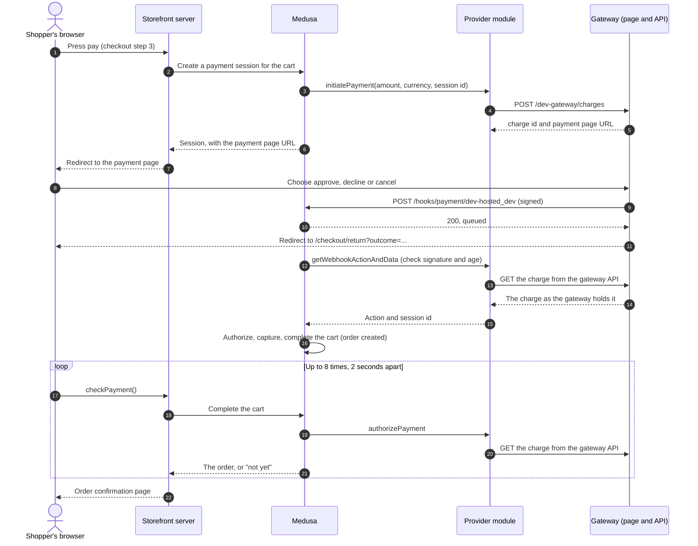

# Payments

This document describes how checkout takes a payment today, and how to connect a real Israeli payment provider.

**No real payment provider is connected, and none has been chosen.** What exists is a simulated provider that behaves like a hosted payment page, so the whole checkout can be built and tested. It moves no money and accepts no card details. It cannot be loaded in production.

The design rule that everything below follows: **the shopper's browser never decides that an order is paid.** Medusa calculates every total, the payment happens on a page that is not part of the storefront, and an order is created only after Medusa's server has asked the payment provider's server what happened.

## What exists now

| Piece | Where | Role |
|---|---|---|
| Payment provider `payment-dev-hosted` | `apps/backend/src/modules/payment-dev-hosted/` | Medusa's side: implements Medusa's payment provider methods by calling the gateway. Its Medusa id is `pp_dev-hosted_dev`. |
| Gateway module `dev-gateway` | `apps/backend/src/modules/dev-gateway/` | Stands in for the provider's own systems. One table, `dev_gateway_charge`, holds what a real gateway would hold on its servers. |
| Gateway API and payment page | `apps/backend/src/api/dev-gateway/` | `POST /dev-gateway/charges`, `GET` and `POST /dev-gateway/charges/:id`, `POST /dev-gateway/charges/:id/capture`, `/refund`, `/cancel`, and the hosted page at `/dev-gateway/pay/:id`. |
| Gateway workflows | `apps/backend/src/workflows/dev-gateway/` | Create and update a charge, and send the signed webhook. |
| Storefront checkout | `apps/storefront/lib/medusa/checkout.ts` | `startPayment` creates the payment session and redirects; `checkPayment` asks Medusa to complete the cart. |
| Return page | `apps/storefront/app/[locale]/checkout/return/page.tsx`, `components/checkout/payment-result.tsx` | Where the shopper lands after the payment page. |

The gateway happens to run inside the same backend process, but the provider talks to it only over HTTP, with a shared secret, exactly as it would talk to an outside company. That keeps the provider's code shaped like a real integration.

### It only loads outside production

The guard is at the top of `apps/backend/medusa-config.ts`:

```ts
const APP_ENV = (process.env.APP_ENV ||
  (process.env.NODE_ENV === "production" ? "production" : "development")) as AppEnv
const isProduction = APP_ENV === "production"

const paymentDevEnabled = process.env.PAYMENT_DEV_ENABLED === "true"
if (paymentDevEnabled && isProduction) {
  throw new MedusaError(
    MedusaError.Types.INVALID_ARGUMENT,
    "PAYMENT_DEV_ENABLED=true is not allowed when APP_ENV=production. " +
      "The development payment provider must never run in production."
  )
}
if (paymentDevEnabled && !process.env.PAYMENT_DEV_WEBHOOK_SECRET) {
  throw new MedusaError(
    MedusaError.Types.INVALID_ARGUMENT,
    "PAYMENT_DEV_ENABLED=true requires PAYMENT_DEV_WEBHOOK_SECRET."
  )
}
```

What this means in practice:

- **Switched on in production, the backend does not start.** The configuration file throws while it is being loaded, with the message above. Nothing is served.
- **`APP_ENV` decides, not `NODE_ENV`.** A production build run for testing sets `APP_ENV=staging` and may use the simulated provider. If `APP_ENV` is not set at all and `NODE_ENV=production`, the deployment counts as production.
- **Switched off, none of it exists.** The provider and the gateway module are registered only inside `if (paymentDevEnabled)`. Each gateway route file disables itself when the provider is off or the deployment is production (`defineFileConfig({ isDisabled: () => !isDevPaymentEnabled() })`), and Medusa does not register a disabled route.
- **The region starts with no payment provider.** The base store setup (`src/migration-scripts/initial-data-seed.ts`) creates the Israel region with an empty provider list. Only the demo seed attaches the simulated provider, and the demo seed refuses to run when `APP_ENV=production`.
- **With no provider on the region, checkout stops at the payment step** with the message "Online payment is not active yet". No order can be placed.
- **At the proxy** (`infrastructure/docker/Caddyfile`), the public API hostname passes on `/dev-gateway/pay/*` only, and the dashboard hostname refuses `/dev-gateway` altogether. The gateway's API (`/dev-gateway/charges`) is reachable only inside the server's private network.

### Settings

| Variable | Meaning |
|---|---|
| `PAYMENT_DEV_ENABLED` | `true` loads the simulated provider. Local default: `true`. Production template: `false`. |
| `PAYMENT_DEV_WEBHOOK_SECRET` | The secret shared by the provider and the gateway. It authenticates API calls between them and signs webhooks. Required when the provider is on. |
| `PAYMENT_DEV_GATEWAY_URL` | Optional. Where the provider and the gateway reach each other. Defaults to `MEDUSA_BACKEND_URL`; the production Compose file sets it to the backend's private address. |
| `PAYMENT_DEV_CAPTURE_MODE` | Optional. `automatic` (default): approving also charges. `manual`: approving only authorizes, and the charge is captured later from the admin. |
| `MEDUSA_BACKEND_URL` | The public address used in the link to the payment page. |
| `STOREFRONT_URL` | Where the shopper is sent back to: `<STOREFRONT_URL>/checkout/return`. |

## The flow



The same thing in words:

1. **The shopper presses "pay".** The storefront's server action `startPayment` reads the cart from Medusa, checks that it has an email, an address and a shipping method, and asks Medusa which payment providers the cart's region has.
2. **Medusa creates the payment session** for the cart's current total. The storefront sends no amount. Medusa calls the provider's `initiatePayment` with the amount, the currency and the payment session id.
3. **The provider creates a charge at the gateway** (`POST /dev-gateway/charges`, authenticated with the shared secret). The gateway stores the amount, generates a random page token, and answers with the charge id and the address of the payment page. The provider stores those on the payment session. Nothing sensitive is stored there.
4. **The storefront redirects the browser** to the payment page. It accepts only an `http` or `https` address.
5. **The shopper acts on the payment page.** The page shows the amount held by the gateway and three buttons that stand for the three outcomes a real page can produce: approved, declined, canceled. It has no card fields. The page cannot be opened or submitted without the page token from the link.
6. **The gateway records the outcome and notifies Medusa**, server to server, before it sends the browser anywhere. The webhook is a `POST` to `/hooks/payment/dev-hosted_dev` with two headers: `x-dev-gateway-timestamp`, and `x-dev-gateway-signature`, which is the HMAC-SHA256 of `<timestamp>.<body>` under the shared secret. Delivery is retried twice if it fails.
7. **Medusa accepts the webhook and queues it.** Its built-in route checks that the provider is enabled, puts the event on the queue with a one-second delay (`webhook_delay` in `medusa-config.ts`), and answers 200. Nothing has been verified yet at this point.
8. **The provider verifies the webhook** in `getWebhookActionAndData`. The timestamp must be within 300 seconds of now and the signature must match, compared in constant time. If either check fails, the webhook is logged as rejected and ignored; the sender still received a 200 in step 7.
9. **The provider asks the gateway for the charge** (`GET /dev-gateway/charges/:id`). The signature proves who sent the webhook; the state of the charge is still taken from the gateway's API, never from the webhook body.
10. **Medusa acts on the answer.** For an approved charge Medusa authorizes the payment session (which makes the provider ask the gateway once more), captures the payment, and completes the cart, which creates the order. For a declined or canceled charge Medusa does nothing: the cart stays as it was and the shopper can try again.
11. **The browser arrives at `/checkout/return`.** The `outcome` in the address only chooses which message to show first. For "declined" and "canceled" the page shows the message and a button back to the payment step. Otherwise it calls `checkPayment` up to 8 times, 2 seconds apart.
12. **`checkPayment` asks Medusa to complete the cart.** Medusa asks the provider, and the provider asks the gateway. If the gateway says the charge is approved, the answer is the order, the cart cookie is cleared and the shopper is sent to the confirmation page. If not, the answer is "not yet". After 8 attempts the page says that no confirmation has arrived and offers to check again.

Three consequences are worth spelling out:

- **An order can be created by the webhook or by the return page's check, whichever comes first.** Both end in the same place: Medusa's server asking the gateway's server. Medusa's cart completion takes a lock on the cart and returns the existing order if one was already created, so the two paths do not produce two orders.
- **A lost webhook does not lose the order** as long as the shopper returns to the storefront, and a shopper who closes the tab does not lose the order as long as the webhook arrives.
- **Going straight to `/checkout/return?outcome=approved` achieves nothing.** The page asks Medusa, Medusa asks the gateway, the gateway says the charge is still pending.

In local development one backend process does everything. In the production layout the webhook is received by `medusa-server` and processed by `medusa-worker`.

## How the provider implements Medusa's methods

Medusa's `AbstractPaymentProvider` has ten methods that a provider must implement. `apps/backend/src/modules/payment-dev-hosted/service.ts` implements all ten, plus the static `validateOptions`.

| Method | When Medusa calls it | What the simulated provider does |
|---|---|---|
| `validateOptions` (static) | When the provider is registered | Fails start-up unless `gatewayUrl`, `webhookUrl`, `returnUrl` and `secret` are set. |
| `initiatePayment` | A payment session is created | `POST /dev-gateway/charges` with the session id as the charge's reference, the amount, the currency, the capture mode, the webhook address and the return address. Returns status `pending` and the payment page URL in the session data. |
| `updatePayment` | The session's amount changes | `POST /dev-gateway/charges/:id` with the new amount. The gateway refuses if the charge is no longer pending. |
| `deletePayment` | The session is deleted | Cancels the charge at the gateway, if there is one. |
| `authorizePayment` | The cart is being completed | `GET /dev-gateway/charges/:id` and maps the answer. It always asks the gateway, so completing a cart before the shopper has paid returns `pending` and creates no order. |
| `getPaymentStatus` | Medusa wants the current status | The same `GET`, mapped the same way. |
| `retrievePayment` | Medusa wants the provider's data | The same `GET`; returns the charge data. |
| `capturePayment` | A payment is captured, automatically or from the admin | `POST /dev-gateway/charges/:id/capture`. The gateway requires an approved charge and captures the full amount. |
| `refundPayment` | A refund is issued from the admin | `POST /dev-gateway/charges/:id/refund` with the amount. The gateway refuses more than was captured and not yet refunded, so partial refunds work. |
| `cancelPayment` | A payment is canceled | `POST /dev-gateway/charges/:id/cancel`. The gateway refuses if anything was captured: a captured charge must be refunded. |
| `getWebhookActionAndData` | A webhook has arrived | Steps 8 and 9 above. Returns the action and `session_id`, which is how Medusa finds the cart. |

How the gateway's state maps to Medusa's:

| Charge at the gateway | Payment session status | Webhook action |
|---|---|---|
| `pending` | `pending` | `pending` (ignored by Medusa) |
| `approved`, full amount captured | `captured` | `captured`: authorize, capture, complete the cart |
| `approved`, not captured | `authorized` | `authorized`: authorize and complete the cart |
| `declined` | `error` | `failed` (ignored by Medusa) |
| `canceled` | `canceled` | `canceled` (ignored by Medusa) |

What the simulation does not cover: 3-D Secure, installments, saved cards, invoices, partial capture, sessions that expire, and anything that involves a card.

## What the tests show

The browser suite in `e2e/tests/checkout.spec.ts` goes through the real storefront, the real Medusa backend and the simulated gateway. It is run by hand against a local stack ([local-development.md](local-development.md#browser-tests-playwright)); no CI runs it yet.

| Test | What it asserts |
|---|---|
| "a guest buys a product: approved payment creates a paid order" | The amount on the payment page is the total Medusa calculated (product plus express shipping). After approving, the shopper reaches the confirmation page; the Admin API returns the order with that total, `payment_status` `captured` and the chosen variant; the cart is empty; the confirmation email arrives with the same total. |
| "a declined payment creates no order and keeps the cart" | The return page says the payment was not approved, the cart still holds the product, and the Admin API finds no order for that email. |
| "a canceled payment creates no order and keeps the cart" | The return page says the payment was canceled and no order exists. |
| "returning with a forged success address does not create an order" | Opening `/checkout/return?outcome=approved&charge=dgch_made_up` without paying ends on the "no confirmation yet" message, and no order exists. |

`e2e/tests/account.spec.ts` adds a signed-in purchase that then appears in the customer's order history as paid.

Not covered by any automated test today: a webhook with a wrong or missing signature, a webhook outside the time window, a replayed webhook, the `manual` capture mode, refunds and cancellations from the admin, and the payment page in English or Arabic (it is Hebrew only). The backend has no test files yet.

## Choosing a real provider

Three Israeli providers were looked at: Cardcom, PayPlus and Tranzila. `discovery.md` records that no Medusa v2 provider exists for any of them, so one will have to be written, following the steps in the next section.

**How to read this table.** Every statement is taken from the provider's own public documentation, read on 2026-11-23, and carries a source key. Pages were read through an automated fetch, so re-read the page itself before writing code against a field name. "To confirm with the provider" means the documentation that was read does not say; it does not mean the feature is missing. Nothing here is a statement about fees, contract terms or compliance.

| | Cardcom | PayPlus | Tranzila |
|---|---|---|---|
| **Hosted page, by redirect** | Yes. `POST /api/v11/LowProfile/Create` ("Create a new Iframe \ Redirect page") takes `SuccessRedirectUrl`, `FailedRedirectUrl`, `WebHookUrl` and a free `ReturnValue` that comes back with the result. [C1] | Yes. `POST /api/v1.0/PaymentPages/generateLink` takes `refURL_success`, `refURL_failure`, `refURL_cancel` and `refURL_callback`. [P1] | A hosted iframe at `https://directng.tranzila.com/<terminal>/iframenew.php` with `success_url_address`, `fail_url_address` and `notify_url_address`. [T1] A full-page redirect is described only on the page for the older iframe, which that page says is deprecated with support ending 1 January 2027. [T2] Redirect with the current page: to confirm with the provider. |
| **Checking the result server-side** | `POST /api/v11/LowProfile/GetLpResult` with `TerminalNumber`, `ApiName` and `LowProfileId`. `ResponseCode` 0 means success. [C1] | `POST /api/v1.0/PaymentPages/ipn` with `transaction_uid` or `payment_request_uid`. [P2] The page documents the request and not the response fields: to confirm with the provider. | No transaction lookup was found on the pages read; the Transactions API page documents creating transactions. [T3] A "Handshake" fixes the amount server-side before the page opens; its V1 is marked deprecated and its V2 page had no content when read. [T2] [T4] How to verify a result: to confirm with the provider. |
| **Webhook authentication** | None described. The API document defines the call to `WebHookUrl` (a `POST` carrying the result) with no signature, secret or header. [C1] Treat it as a trigger only and call `GetLpResult`. Whether signing or fixed source addresses are available: to confirm with the provider. | A `hash` header: base64 HMAC-SHA256 of the body under the API secret key, with `user-agent: PayPlus`. [P3] The sample hashes the re-serialised JSON body; whether that always equals the bytes received: to confirm with the provider. | None described for `notify_url_address` on either iframe page: no signature, and the HTTP method is not stated. [T1] [T2] To confirm with the provider. |
| **Authorize, then capture (J5)** | `AdvancedDefinition.JValidateType` takes 2 (J2, card check) or 5 (J5, authorization); a related description ties it to the `CreateTokenOnly` and suspended-deal operations. `Transactions/Transaction` has an `ApprovalNumber` described as capturing a J5 request. [C1] How to authorize on the hosted page and capture later: to confirm with the provider. | `charge_method: 2` is "Approval (J5)". [P1] Capture with `POST /api/v1.0/Transactions/ChargeByTransactionUID`, for no more than the original J5 amount. [P4] | Iframe `tranmode=V` is "Verification (J5)". [T1] By API: `txn_type` `verify` with `verify_mode` 5, then `force` with `reference_txn_id`; `reversal` releases the hold. [T3] |
| **Refunds** | `POST /api/v11/Transactions/RefundByTransactionId` with `ApiName`, `ApiPassword`, `TransactionId`; optional `PartialSum`; `CancelOnly` for cancelling before deposit. [C1] | `POST /api/v1.0/Transactions/RefundByTransactionUID` with `transaction_uid` and `amount`. [P5] | `txn_type` `credit` with `reference_txn_id` and `authorization_number`; `cancel` cancels a transaction. [T3] |
| **Installments (tashlumim)** | `AdvancedDefinition.MinNumOfPayments` and `MaxNumOfPayments`, 1 to 36. [C1] | `payments` and `payments_selected` on `generateLink`. [P1] | `cred_type` 8 (installments) or 6 (credit installments, minimum 3), with `maxpay` or `npay`/`fpay`/`spay`. [T1] By API: `payment_plan` and `installments_number`, 1 to 36. [T3] |
| **Saving a card (tokens)** | `Operation` `ChargeAndCreateToken` or `CreateTokenOnly`; the token comes back in `TokenInfo`. [C1] | `create_token` on `generateLink`; token endpoints (add, check, list, update, remove) are in the API index. [P1] [P0] | `TranzilaTK` is returned "if tokenization is enabled"; `tranmode=K` creates a token without checking the card. [T1] What enabling it requires: to confirm with the provider. |
| **Invoice or receipt** | A `Document` object on `LowProfile/Create`; the result carries `DocumentInfo` with a document URL; there are separate `Documents` endpoints. [C1] Whether document creation is part of the account or a paid module: to confirm with the provider. | `initial_invoice` on `generateLink`. [P1] The refund page says a document is generated when the account is connected to "Invoice+". [P5] What Invoice+ costs and covers: to confirm with the provider. | `json_purchase_data` on the iframe, which the page says requires the invoice module. [T1] A separate Invoices API (`POST /api/documents_db/create_document`) with document types IR, RE, DI and IN. [T5] |
| **How our server authenticates to the provider** | `TerminalNumber` and `ApiName` in the request body; `ApiPassword` as well for refunds. [C1] | `api-key` and `secret-key` headers. [P1] | Four headers: app key, request time, nonce, and an HMAC-SHA256 access token. [T6] |
| **Test environment** | To confirm with the provider. | A staging host, `restapidev.payplus.co.il`, is listed next to production. [P1] | To confirm with the provider. |
| **Fees** | To confirm with the provider. | To confirm with the provider. | To confirm with the provider. |

Sources:

| Key | Page |
|---|---|
| C1 | Cardcom API v11, OpenAPI document: `https://secure.cardcom.solutions/swagger/v11/swagger.json` |
| P0 | PayPlus API index: `https://docs.payplus.co.il/llms.txt` |
| P1 | PayPlus, Generate Payment Link: `https://docs.payplus.co.il/reference/post_paymentpages-generatelink` |
| P2 | PayPlus, IPN: `https://docs.payplus.co.il/reference/post_paymentpages-ipn` |
| P3 | PayPlus, Validate Requests Received from PayPlus: `https://docs.payplus.co.il/reference/validate-requests-received-from-payplus` |
| P4 | PayPlus, Charge by Transaction UID: `https://docs.payplus.co.il/reference/post_transactions-chargebytransactionuid` |
| P5 | PayPlus, Refund By Transaction UID: `https://docs.payplus.co.il/reference/post_transactions-refundbytransactionuid` |
| T1 | Tranzila, Iframe Integration new DirectNG: `https://docs.tranzila.com/docs/payments-and-billing/iframe-integration-directng` |
| T2 | Tranzila, Iframe Integration (older): `https://docs.tranzila.com/docs/payments-and-billing/iframe-integration` |
| T3 | Tranzila Transactions API: `https://docs.tranzila.com/docs/payments-and-billing/tranzila-api` |
| T4 | Tranzila, Handshake API V2 (no content when read): `https://docs.tranzila.com/docs/payments-and-billing/handshake-api-v2` |
| T5 | Tranzila, Invoices API: `https://docs.tranzila.com/docs/invoices/invoices-api` |
| T6 | Tranzila, Authentication: `https://docs.tranzila.com/docs/payments-and-billing/authentication` |

What the table means for the design:

- All three fit the flow this project already uses: create a payment page server-side, redirect, be notified server to server, then confirm server to server.
- Where the notification is not signed, or signing could not be confirmed, the notification must be treated as a hint and the result fetched from the provider with our own credentials. The simulated provider already works this way even though its webhook is signed.
- Questions to put to each provider before choosing are the "to confirm" cells, plus: fees, settlement times, which card brands and wallets are included, and how chargebacks are reported.

## Adding a provider to this repository

The example uses `cardcom` as the name. Substitute the provider chosen. The variable names in step 4 are proposals; they do not exist yet.

### 1. Create the provider module

Create `apps/backend/src/modules/payment-cardcom/` with two files, modelled on `payment-dev-hosted`:

- `index.ts`: `export default ModuleProvider(Modules.PAYMENT, { services: [CardcomPaymentProviderService] })`
- `service.ts`: a class that extends `AbstractPaymentProvider<Options>` with `static identifier = "cardcom"` and a static `validateOptions` that fails when a credential is missing.

No database migration is needed. A provider has no tables of its own; what it needs to remember goes in the payment session's `data`.

### 2. Implement the ten methods

Use the table in [How the provider implements Medusa's methods](#how-the-provider-implements-medusas-methods) as the checklist. The points that matter most:

- **`initiatePayment`** creates the hosted page at the provider and must return its address as `data.payment_url`. That is the field the storefront redirects to (`startPayment` in `apps/storefront/lib/medusa/checkout.ts`). Send Medusa's payment session id (`input.data.session_id`) to the provider as the merchant's own reference, so that it comes back with the result.
- **The amount** is the one Medusa passes in, in shekels with decimals, not agorot. Never recompute it and never accept one from the browser.
- **Return addresses.** Point the provider's success, failure and cancel addresses at `<STOREFRONT_URL>/checkout/return` with `?outcome=approved`, `declined` or `canceled`. The value is only a hint for the first message shown.
- **`authorizePayment` and `getPaymentStatus`** must call the provider's result API every time and map its answer. They must not rely on anything stored earlier.
- **`getWebhookActionAndData`** receives `payload.data` (the parsed body), `payload.rawData` (the bytes as received) and `payload.headers`. Verify the signature over `rawData` where the provider signs. Then fetch the result from the provider's API regardless, and check that the amount and currency match what the payment session expects. Return `data.session_id`; Medusa ignores a webhook result that has none.
- **Never store or log** card numbers, CVV, or full provider responses that might contain them.

### 3. Register it in `medusa-config.ts`

Today the payment module is added to `modules` only inside `if (paymentDevEnabled)`. Change that section so the module is added whenever at least one provider is configured, with the provider list built from the environment: the real provider when its credentials are present, the simulated one when `PAYMENT_DEV_ENABLED=true`. Keep the two guards at the top of the file unchanged.

A provider entry looks like this:

```ts
{
  resolve: "./src/modules/payment-cardcom",
  id: "cardcom",
  options: {
    /* credentials and URLs, read from process.env */
  },
}
```

Medusa names a provider `pp_<identifier>_<id>`, so this one is `pp_cardcom_cardcom`.

### 4. Add the settings

- Add the variables to `.env.example`, in the `#@file apps/backend/.env` section, with a comment for each. For Cardcom that would be something like `PAYMENT_CARDCOM_TERMINAL`, `PAYMENT_CARDCOM_API_NAME` and `PAYMENT_CARDCOM_API_PASSWORD`. Leave them empty in the example; real values go only into the server's environment and the owner's password manager.
- Add them to `infrastructure/docker/.env.production.example`, and to the `x-backend-environment` block of `infrastructure/docker/compose.prod.yaml`. That block is an explicit list: a variable that is not named there never reaches the containers.

### 5. Register the webhook address with the provider

Medusa's webhook route is `/hooks/payment/<identifier>_<id>`. For this example:

```
https://<public API hostname>/hooks/payment/cardcom_cardcom
```

The proxy already passes `/hooks/*` on the public API hostname and refuses it on the dashboard hostname. Requests to it are limited to 2 MB.

Two things to check with the real provider, because the simulated one does not exercise them:

- Medusa answers 200 as soon as the webhook is queued, before the provider module has verified it. A provider that expects a particular response body needs a closer look.
- The simulated webhook is JSON. If the provider sends form-encoded data, confirm that the body reaches `getWebhookActionAndData` intact.

### 6. Attach the provider to the region

A provider takes payments only for regions it is attached to. In the admin: Settings, Regions, the Israel region, payment providers. Remove any other provider from the region at the same time.

### 7. Check the storefront

The storefront needs no change if the provider returns `data.payment_url` and sends the shopper back to `/checkout/return`. Two details to test in a real browser:

- **How the shopper is sent back.** The cart cookie is `SameSite=Lax`, and browsers do not send such a cookie on a cross-site `POST`. If the provider returns the shopper with a `POST`, the return page will not see the cart. Use a `GET` return where the provider offers the choice.
- **Languages.** The provider gets one return address, without a language. The return page forwards English and Arabic shoppers using the `bnz_locale` cookie.

### 8. Write the tests

| Test | Kind | Where |
|---|---|---|
| Status mapping for every provider state | Jest unit test | `apps/backend/src/modules/payment-cardcom/__tests__/*.unit.spec.ts` |
| Webhook verification: valid, wrong signature, missing signature, signature with extra characters appended, stale timestamp if the provider has one | Jest unit test | Same folder |
| Amount or currency in the provider's result differs from the session: rejected | Jest unit test | Same folder |
| A forged webhook creates no order; a replayed webhook creates no second order | HTTP integration test with the provider's API stubbed | `apps/backend/integration-tests/http/*.spec.ts` |
| Approve, decline, cancel, and the forged return address, against the provider's test environment | Playwright | A copy of the four tests in `e2e/tests/checkout.spec.ts`; the helper `checkoutToPaymentPage` waits for the simulated page's address and needs a version for the real one |
| Refund from the admin, full and partial; capture after J5 if that mode is used; installments if offered | By hand at first | Record the steps in this document |

The file locations match the patterns in `apps/backend/jest.config.js`.

### 9. Keep the simulated provider

Leave `payment-dev-hosted` in place for local development and for the browser suite. It cannot load in production, and it keeps the tests independent of a third party's test environment.

## Go-live checklist

This list is about the payment integration only. It asserts nothing about legal or regulatory compliance; the items marked **[Professional]** need a qualified person's decision.

**Scope of card data**

- [ ] Card details are entered only on the provider's hosted page. This site has no field for a card number, expiry date or CVV, and no code path that receives them.
- [ ] No provider API that accepts raw card data is called from this codebase.
- [ ] Logs contain no provider responses that could include card data.
- [ ] **[Professional]** The provider or acquirer has confirmed which PCI DSS obligations remain with the business under a hosted-page integration.

**Configuration**

- [ ] On the server, `APP_ENV=production` and `PAYMENT_DEV_ENABLED=false`.
- [ ] The Israel region has exactly one payment provider: the real one.
- [ ] Medusa's built-in `pp_system_default` provider is **not** attached to the region. Medusa always registers it, and it approves payments without calling anyone.
- [ ] Provider credentials exist only in the server's environment and the owner's password manager.
- [ ] The webhook address is registered with the provider and reachable from the internet through Cloudflare and the proxy. No Cloudflare rule or Access policy blocks it.

**Behaviour, tested against the provider's test environment and then once with a real card**

- [ ] Approved, declined and canceled payments each end the way the four browser tests describe.
- [ ] The amount on the provider's page equals Medusa's total, including shipping and discounts.
- [ ] A forged return address creates no order. A forged webhook creates no order.
- [ ] The same webhook delivered twice creates one order.
- [ ] Closing the browser on the provider's page after paying still produces the order, through the webhook.
- [ ] A refund issued from the admin reaches the provider, in full and in part.
- [ ] The return works in Hebrew, English and Arabic.
- [ ] The order confirmation email is sent through the production mail server.

**Business decisions**

- [ ] Charge at once, or authorize (J5) and capture on dispatch.
- [ ] Whether installments are offered, and up to how many.
- [ ] Whether cards may be saved. Today nothing is saved.
- [ ] **[Professional]** Invoices and receipts: who issues them (the provider's document service or separate invoicing software), in what form, and how VAT is reported. This is an accountant's decision.
- [ ] **[Professional]** The VAT rate configured in the admin (Settings, Tax Regions) has been confirmed by an accountant.
- [ ] **[Professional]** The terms of sale, cancellation and refund policy have been reviewed by a lawyer.
